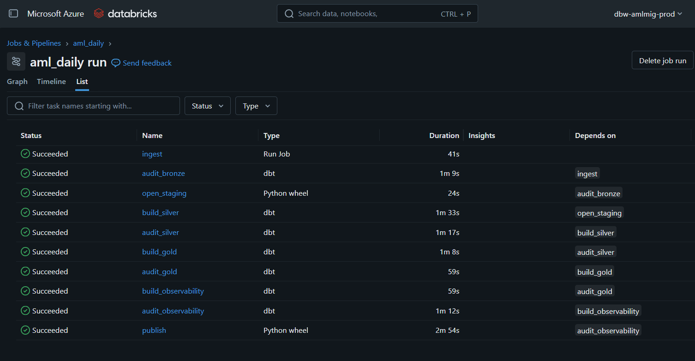
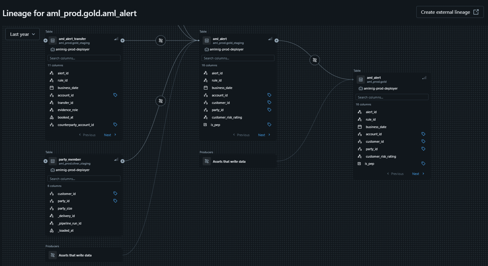
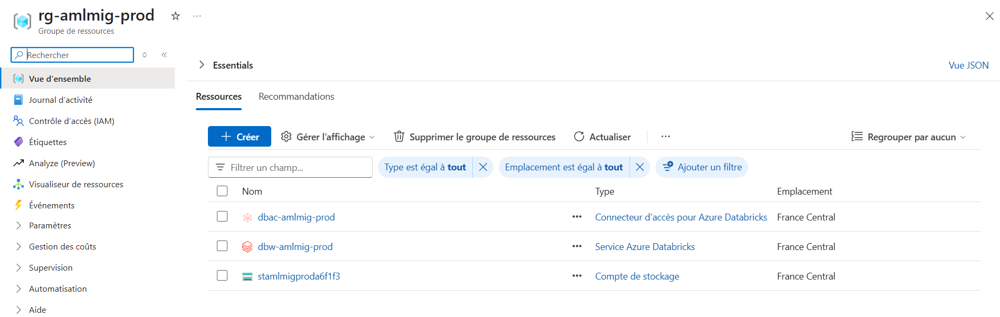
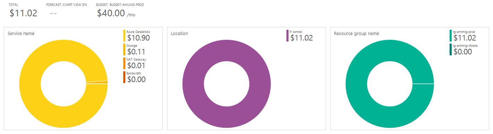

# AML lakehouse migration to Azure Databricks

Hybrid migration of an on-premises anti-money-laundering lakehouse (Spark, Iceberg, Nessie,
Trino, dbt, Airflow) to Azure Databricks with Unity Catalog. Personal data stays on premises;
what moves is proved identical by a parallel run before the cutover, and the cutover is reversible
by one setting.

**Status: complete.** Assessed, migrated in four waves, run in parallel, cut over and rolled back
on prod, then the Azure window closed: every object created was destroyed and looked up again
afterwards. The source is the publisher of record again; its decommissioning is planned, not
executed.

| Result | Measured | Evidence |
|---|---|---|
| Parity of the parallel run | 12 tables equal over 18 business dates, 8,132,982 rows each side, zero difference on alerts | [parity](docs/assessment/parity.md) |
| AML alerts, source and target | 19,395 and 19,395; 98 sanctions hits each | [parity](docs/assessment/parity.md) |
| Personal data crossing the boundary | none: 43 direct identifiers kept on premises, every delivery scanned, 0 false positive on 10.67 M rows | [boundary](docs/assessment/boundary.md), [postmortems](docs/postmortems/) |
| Cutover, executed on prod | switch checks 14 s, **rollback 6 s**, freeze to switch 78 min | [cutover](docs/assessment/cutover.md) |
| Cost of prod, 4 days | 11.02 USD charged by Azure; 10.91 USD of Databricks usage at list price, under the low end of the estimate | [operations](docs/assessment/operations.md), [teardown](docs/assessment/teardown.md) |
| Teardown | 50 objects of 2 Terraform states looked up after the destroy, 0 left; 0 resources in the subscription | [teardown](docs/assessment/teardown.md), [postmortem](docs/postmortems/teardown-destroy-order.md) |
| Tests | 228 unit tests, 108 dbt data tests, 7 dbt unit tests; CI checks in about a minute | [ci](docs/assessment/ci.md) |

| | |
|---|---|
| Source | [aml-compliance-platform](https://github.com/Revoyaldev/aml-compliance-platform) at the commit pinned in [`source/pin.toml`](source/pin.toml) |
| Target | Azure Databricks, Unity Catalog, Delta Lake, serverless jobs and SQL warehouse |
| Deployment | Databricks Asset Bundles (Declarative Automation Bundles), Terraform for Azure resources |
| Strategy | Re-platform in four waves, parallel run with column-level parity, executed rollback ([ADR 0001](docs/adr/0001-replatform-in-waves.md)) |

## Architecture

![Architecture: on premises, the source lakehouse (Iceberg, Nessie, Trino, dbt, Airflow) keeps every direct identifier and exports one delivery a day through an allow-list, keyed pseudonyms and a PII gate; the delivery crosses the hybrid boundary to a landing volume in Azure Databricks, where a Lakeflow job ingests bronze, builds silver, gold and observability in staging schemas, audits them and publishes; a parallel run checks parity between both sides; Power BI reads the SQL warehouse after the cutover and can be pointed back to Trino as a rollback.](docs/images/architecture.png)

Details: [docs/architecture.md](docs/architecture.md). Steps and exit criteria:
[docs/migration-plan.md](docs/migration-plan.md).

## How it was migrated

**Assessment, generated from the running source** (`make inventory assessment`; CI fails if it goes
stale): 49 objects, 141 tests, 48 SQL functions (39 same name, 8 renamed, 1 without translation),
536 columns classified (43 direct identifiers, 89 indirect), four waves, and a cost estimate of the
Azure window from the retail price API ([inventory](docs/assessment/inventory.md),
[classification](docs/assessment/classification.md), [waves](docs/assessment/waves.md),
[estimate](docs/assessment/cost-estimate.md)).

**Boundary** ([ADR 0003](docs/adr/0003-hybrid-boundary.md)). Columns cross by an allow-list
([`migration/export.yaml`](migration/export.yaml)); account numbers and card tokens become keyed
HMAC pseudonyms whose key never leaves; birth dates cross as years. A PII gate scans every value for
e-mails, phone numbers, RIB/IBAN, CIN and passport numbers, card numbers and customers' full names;
one match blocks the delivery. One sealed delivery per business date: Parquet, a manifest with the
source commit, SHA-256 and control totals per column, uploaded through the Unity Catalog Files API.

**Bronze** ([ADR 0004](docs/adr/0004-bronze-ingestion.md)). A delivery is accepted whole or not at all:
contract, key, checksums, then every control total recomputed by Spark; each decision logged in
`landing.delivery_log`. 18 deliveries, 10,675,262 rows, ingested in 7 min 50 s; a flipped byte and an
undeclared column were rejected.

**Silver and gold** ([ADR 0005](docs/adr/0005-transformations-and-unity-catalog-security.md)). The dbt
project is ported by hand, each change and its reason listed in
[`migration/translation.yaml`](migration/translation.yaml); sqlglot's own translation is measured
against the port (8 of 10 models identical, [translation](docs/assessment/translation.md)). Four
account groups, schema grants, masks on pseudonyms, classification tags, checked in CI
([governance](docs/assessment/governance.md)).

**Orchestration** ([ADR 0006](docs/adr/0006-orchestration-and-write-audit-publish.md)). The Airflow DAG
becomes one Lakeflow job per business date: build in staging schemas, audit each layer, then publish
each table's slice in one commit. Unity Catalog refuses clones and time travel on masked tables, so
staging is kept honest by the run id each slice carries.

**Reliability, security and cost** ([ADR 0009](docs/adr/0009-reliability-security-and-cost.md)). The
source's data observability is a fourth audited layer: volume against a baseline, distribution
drift, and records and amounts reconciled from manifest to silver (36 of 36 feeds). Lineage recorded
by Unity Catalog matches dbt's graph edge for edge (59 of 59); access is reported by role; liquid
clustering is measured on bytes read ([operations](docs/assessment/operations.md),
[clustering](docs/assessment/clustering.md)).

**Parity** ([ADR 0008](docs/adr/0008-migration-acceptance-and-parity.md)). `make parity` fingerprints
every column of each table and date on both sides (counts, nulls, distinct values, sums, 256 hashed
buckets of rows) and compares differing buckets row by row; pseudonymized columns are compared
through the same key. Acceptance: zero difference on alerts, every other difference explained.

**Cutover** ([ADR 0010](docs/adr/0010-cutover-and-rollback.md), [runbook](docs/cutover.md)). The
source's Power BI report is rendered, not forked: only where it reads changes, behind one dataset
parameter. Go/no-go is a set of recorded checks against both platforms. Executed on prod, including
a rotation of the pseudonymization key in one all-or-nothing run.

## Evidence from prod

Captured on the Azure workspace before the teardown.

| | |
|---|---|
|  |  |
| One business date through write-audit-publish | Lineage recorded by Unity Catalog for the alerts table |
|  |  |
| Azure resources created by Terraform | Cost Management, whole subscription, before the teardown |

## Closing the window

Prod ran on a free Azure subscription with a spending limit, for a window that ended before its
credit did ([ADR 0007](docs/adr/0007-azure-infrastructure-identities-and-cost.md)). It was closed in
reverse order of creation, each part by its owner: the bundle's schemas and jobs by the CI service
principal, then `terraform destroy` of prod, then of the state account. Before the destroy, the
identifier of every object the states managed was kept; after it, `make teardown` looked each one up
in Resource Manager, Entra ID and the Databricks account, swept the subscription and recorded the
cost per day: nothing left, 11.02 USD over 4 days
([procedure](docs/migration-plan.md#closing-the-azure-window), [teardown](docs/assessment/teardown.md)).
The destroy stopped three times on dependencies no reference expresses, and one identity was only
deactivated; the causes are fixed in the configuration
([postmortem](docs/postmortems/teardown-destroy-order.md)).

The window ended inside the cutover's rollback window, so the source is the publisher of record
again and its analytical layers are not decommissioned. The plan to do so, with its preconditions
and order, is [docs/decommissioning.md](docs/decommissioning.md).

## Data

The source holds 5,078,345 payment transfers and 1,800,000 card transactions over 18 business
dates, 167,848 customers, 518,581 accounts and 87,451 cards from its core banking, and the UN and
OFAC sanctions lists ([inventory](docs/assessment/inventory.md)).

## Environments

| | dev | prod |
|---|---|---|
| Workspace | Databricks Free Edition | Azure Databricks Premium, serverless, France Central |
| Storage | Workspace default storage | ADLS Gen2 behind Unity Catalog external locations |
| Catalog | `aml_dev` | `aml_prod`, bound to the prod workspace |
| Infrastructure | — | Terraform in [`infra/terraform`](infra/terraform), applied and destroyed by an operator from reviewed plans |
| CI identity | Token in the `dev` GitHub environment | Service principal through OpenID Connect, no stored secret |
| Deployed | Every pull request and push to `main` | On demand (`workflow_dispatch`: deploy, or destroy the bundle) |

Every deployment runs `platform_check` (catalog, schemas, a managed table write, runtime versions)
and a Files API round trip on the landing volume.

## Development

Requires [uv](https://docs.astral.sh/uv/) and the Databricks CLI version pinned in `databricks.yml`.

```bash
make install            # package, assessment tooling, dev tools
make test               # lint, types, unit tests, assessment up to date
make assessment         # re-render docs/assessment/ after changing migration/*.yaml
make validate deploy platform-check transfer-check TARGET=dev   # needs DATABRICKS_HOST and DATABRICKS_TOKEN
make daily DATE=2022-09-18 TARGET=dev                            # daily job of one business date
make infra-check                                                 # terraform fmt, validate, TFLint (no Azure access)
```

On premises, next to the running source ([migration plan](docs/migration-plan.md#exporting-and-delivering),
[runbook](docs/runbook.md)):

```bash
make key                                         # once; back it up on premises, it never leaves
make export FROM=2022-09-01 UNTIL=2022-09-18     # deliveries in exports/
make deliver TARGET=dev                          # upload to /Volumes/aml_dev/landing/deliveries
make parity TARGET=dev FROM=2022-09-01 UNTIL=2022-09-18 SOURCE_DIR=<source checkout>
```

Every target: `make help`.

## Decisions

| ADR | Decision |
|---|---|
| [0001](docs/adr/0001-replatform-in-waves.md) | Re-platform in waves, generated assessment, parallel run as proof |
| [0002](docs/adr/0002-azure-databricks-and-delta.md) | Azure Databricks with Unity Catalog and Delta; Free Edition for dev; dbt as a job task |
| [0003](docs/adr/0003-hybrid-boundary.md) | Column policy, keyed pseudonyms, PII gate, sealed daily deliveries over the Files API |
| [0004](docs/adr/0004-bronze-ingestion.md) | Bronze ingestion by whole delivery: contract, checksums, control totals, delivery log; no Auto Loader |
| [0005](docs/adr/0005-transformations-and-unity-catalog-security.md) | dbt project ported by hand with sqlglot as the measure; schema grants to account groups, pseudonym masks, classification tags |
| [0006](docs/adr/0006-orchestration-and-write-audit-publish.md) | One Lakeflow job per business date replaces the Airflow DAG; write-audit-publish through staging schemas and a run-checked publication |
| [0007](docs/adr/0007-azure-infrastructure-identities-and-cost.md) | Serverless Azure Databricks workspace; Terraform outside the catalog, bundle inside; OpenID Connect deployment; cost guardrails; verified teardown |
| [0008](docs/adr/0008-migration-acceptance-and-parity.md) | Acceptance by a parallel run: hashed fingerprints per table and date, differing buckets compared row by row, zero difference on alerts |
| [0009](docs/adr/0009-reliability-security-and-cost.md) | Source checks ported as an audited layer; lineage checked against dbt's graph; access reported by role; cost measured against the estimate; liquid clustering on the two large tables |
| [0010](docs/adr/0010-cutover-and-rollback.md) | Report rendered with a serving parameter; cutover and rollback as a parameter change; go/no-go as recorded checks; key rotation all or nothing |
