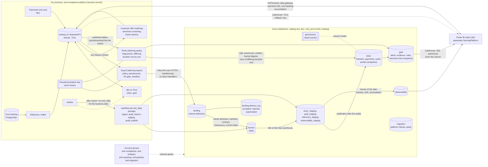
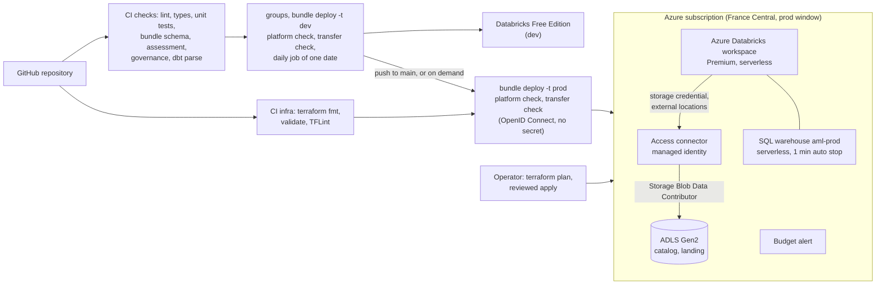
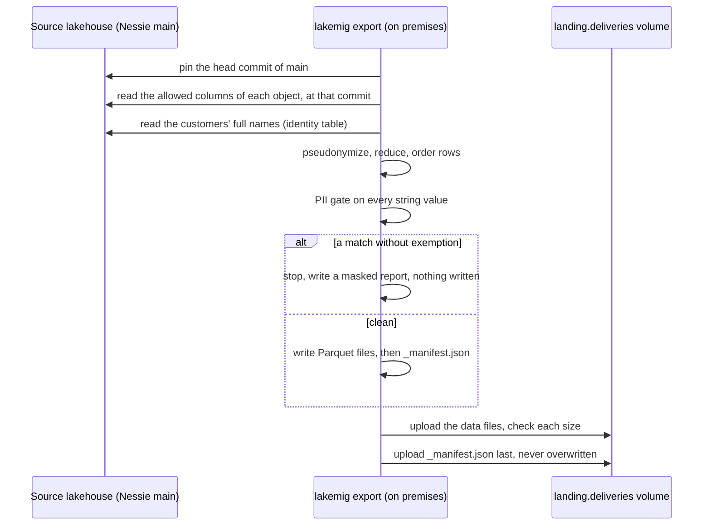
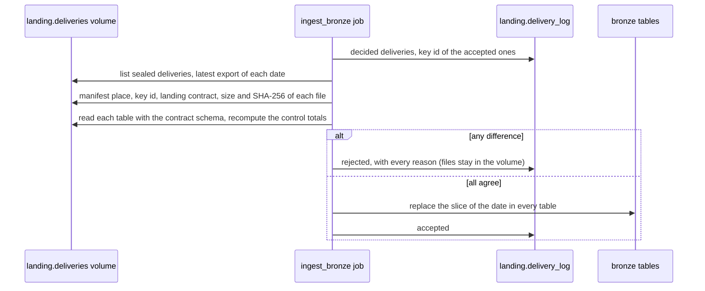
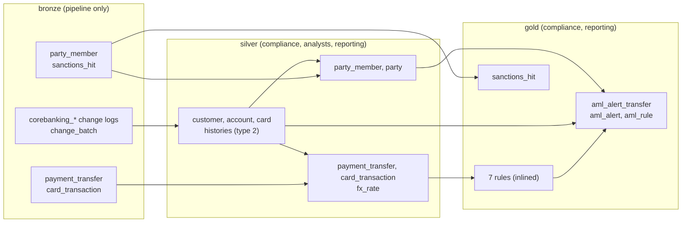
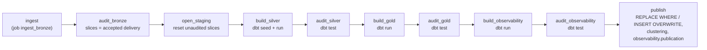

# Architecture

The source platform keeps everything that needs a direct identifier; the cloud platform receives
exports without them and rebuilds the rest. Solid arrows exist today; dashed ones are built by the
step named on them.

## Deployment

| Concern | dev | prod |
|---|---|---|
| Workspace | Databricks Free Edition | Azure Databricks Premium, serverless, France Central |
| Storage | Workspace default storage | ADLS Gen2 behind Unity Catalog external locations; `landing.deliveries` is an external volume |
| Catalog | `aml_dev`, created with SQL (`make catalog`) | `aml_prod`, Terraform, bound to the prod workspace only |
| Groups | `make groups` | Terraform, with workspace assignments; operators in `data-platform-admins` |
| CI identity | Personal access token in the `dev` GitHub environment | Service principal through OpenID Connect from the `prod` environment, no stored secret |
| Deployed by | Every pull request and every push to `main` | Push to `main` after dev, or on demand |
| Infrastructure | — | `infra/terraform/prod`, applied by an operator ([ADR 0007](adr/0007-azure-infrastructure-identities-and-cost.md)) |

## The boundary

What crosses, column by column: [`docs/assessment/boundary.md`](assessment/boundary.md).

## Bronze ingestion

## Transformations and access

The daily run of one business date, the source DAG `aml_daily` task for task ([ADR 0006](adr/0006-orchestration-and-write-audit-publish.md)):

Readers only ever see `silver`, `gold`, `reference` and `observability`; dbt writes only their
`_staging` copies, which no group reads. A failed audit leaves the published layers as they were:
a blocking volume anomaly or a feed that does not reconcile holds the date's publication
([ADR 0009](adr/0009-reliability-security-and-cost.md)).

Pseudonym columns read as null outside `aml-compliance` and `aml-pipeline`; every column relating to a
person is tagged with its classification ([governance.md](assessment/governance.md)). What sqlglot
would have translated on its own: [translation.md](assessment/translation.md).

Decisions: [ADR 0001](adr/0001-replatform-in-waves.md) (strategy),
[ADR 0002](adr/0002-azure-databricks-and-delta.md) (platform, format, environments),
[ADR 0003](adr/0003-hybrid-boundary.md) (boundary, gate, transport),
[ADR 0004](adr/0004-bronze-ingestion.md) (bronze ingestion),
[ADR 0005](adr/0005-transformations-and-unity-catalog-security.md) (transformations, access),
[ADR 0006](adr/0006-orchestration-and-write-audit-publish.md) (orchestration, write-audit-publish),
[ADR 0007](adr/0007-azure-infrastructure-identities-and-cost.md) (Azure infrastructure, identities, cost),
[ADR 0008](adr/0008-migration-acceptance-and-parity.md) (acceptance, parity),
[ADR 0009](adr/0009-reliability-security-and-cost.md) (checks, lineage, access, cost, clustering).

## Cutover

The report the compliance team reads is the source's Power BI project, rendered into `bi/` with one
change of substance: its `Lakehouse` expression reads the SQL warehouse or Trino depending on a
dataset parameter, `ServingPlatform`. The cutover sets it to `Databricks`; a rollback sets it back
to `Trino` while the source keeps running for the 14-day rollback window. The sanctions hits (the
listed names never cross) and the core banking reconciliation stay on premises, read through the
data gateway. Each phase's go/no-go checks are code (`make cutover`), recorded and timed in
[assessment/cutover.md](assessment/cutover.md). Decision: [ADR 0010](adr/0010-cutover-and-rollback.md);
procedure: [cutover.md](cutover.md); operations, key rotation included: [runbook.md](runbook.md).
